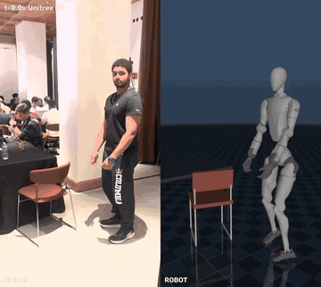
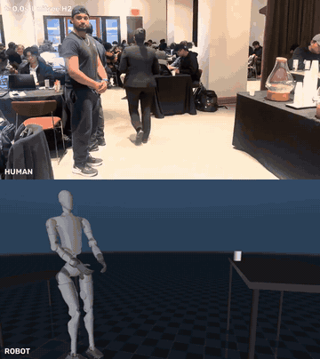
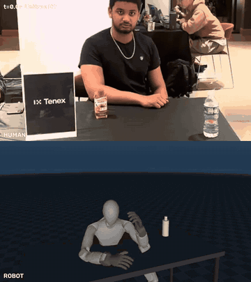
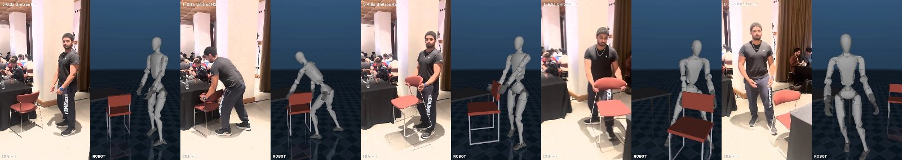
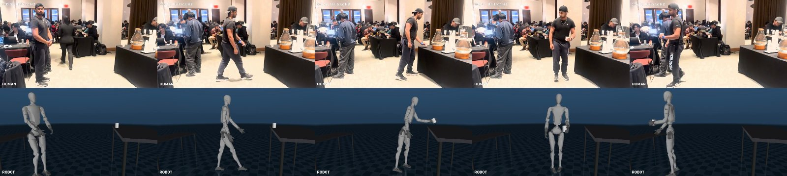
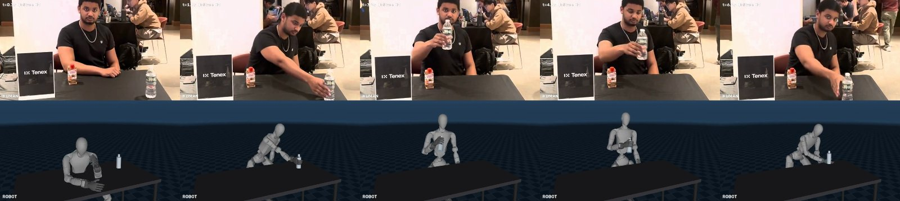
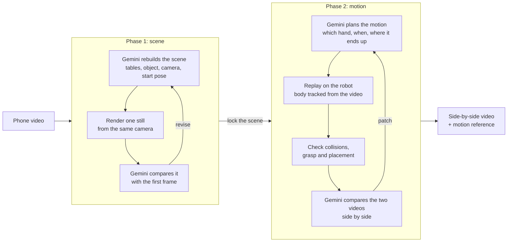
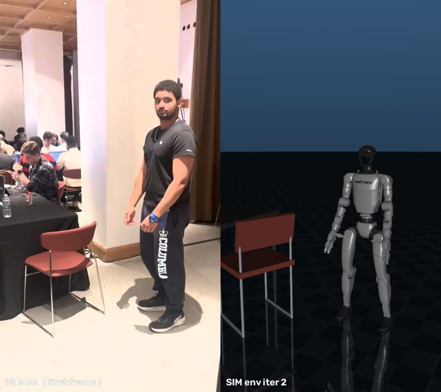
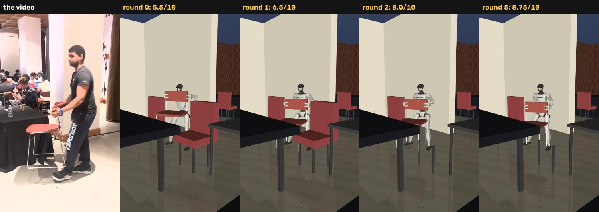
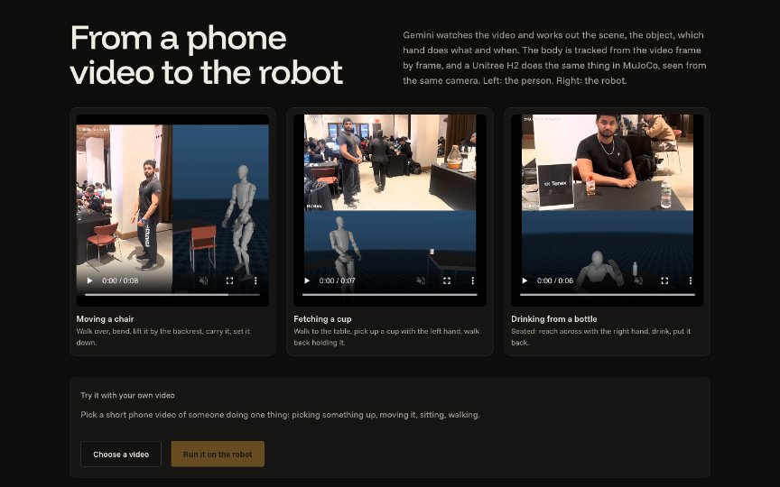

# GetUp: from a phone video to a humanoid robot

**Film someone doing an everyday task on a phone. Gemini works out what's happening, and a Unitree humanoid in MuJoCo does the same thing, seen from the same camera.**

The video can be any short clip: no motion-capture suit, no markers, no calibration, any angle.

<table>
  <tr>
    <td align="center" width="33%"><br><b>Moving a chair</b></td>
    <td align="center" width="33%"><br><b>Fetching a cup</b></td>
    <td align="center" width="33%"><br><b>Drinking from a bottle</b></td>
  </tr>
</table>

<sub>Each clip shows the person's original video, with the robot replaying it next to it (portrait clips) or below it (landscape clips). Full-quality versions: <a href="web/public/mirror/">web/public/mirror/</a>.</sub>

Built in one day at the **Gemini 4 NYC hackathon**, using **Gemini 4 Hydrogen** and **Gemini 4 Carbon**.

### ▶ Live demo: **[(https://jburrell999.github.io/GetUp/))**

Upload your own phone video under **"Try it with your own video"** and get the robot's side-by-side back in about 2–3 minutes.
<sub>Served from the team's laptop through ngrok, so it's only up while that laptop is running. If ngrok shows a warning page, choose **Visit Site**.</sub>

---

## Contents

- [See it step by step](#see-it-step-by-step)
- [How it works](#how-it-works)
- [Try it](#try-it)
- [The website](#the-website)
- [Results](#results)
- [Repository layout](#repository-layout)
- [Limitations and next steps](#limitations-and-next-steps)
- [Credits and disclosures](#credits-and-disclosures)

---

## See it step by step

**Moving a chair:** walk over, bend, lift it by the backrest, carry it, set it down.



**Fetching a cup:** turn, walk to the table, pick up a cup with the left hand, walk back holding it.



**Drinking from a bottle:** seated, reach across with the right hand, drink, put it back.



---

## How it works



### Phase 1: Gemini rebuilds the scene

Gemini watches the video and describes the scene as data:
- the surfaces (tables, counters),
- the object, its shape, size, colour and where it starts,
- where the camera was,
- how the person stands or sits in the first frame.

One frame is rendered from that camera and placed next to the video's first frame. Gemini compares the two and corrects its description until they match, and then the scene is locked.



### Phase 2: Gemini plans and judges the motion

Inside the locked scene, Gemini decides **what** happens:
- which hand grabs the object, and when it lets go,
- where the object ends up,
- where the person steps,
- the pose of any limb the camera can't see.

The rest is measured or computed, not guessed:

| What | How |
|---|---|
| Body pose, every frame | The person's 3D body landmarks from the video (MediaPipe), copied onto the robot's joints as limb directions, so a different body size doesn't matter |
| Camera | Placed from how the person is turned relative to the phone, so both videos share one viewpoint |
| Object position | Taken from where the person's hand is at the grab and at the release |
| Hands on the object | Inverse kinematics puts the palm on the object at the right angle (position has priority) |
| Feet | Planted while standing, so they don't slide |
| Collisions | Every frame is checked: robot against itself, the table, the floor and the object. Small overlaps are pushed apart automatically, and the rest go to Gemini as feedback ("right hand inside table, 4 cm, 1.3–2.5 s") |

Each round renders the robot, puts it next to the original video, and sends **one** side-by-side video to Gemini. Gemini scores how well they match and returns a **patch**: only the parts it wants changed. The loop stops when the match is good, or when it stops improving.

Here is the same moment over several rounds of one run, with Gemini's score climbing from 5.5 to 8.75:



<sub>This run was set inside the event-room background with the earlier G1 robot and both Gemini models judging (see <a href="motion_mirror/benchmarks/MODEL_AB.md">MODEL_AB.md</a>). Current results use the human-sized H2.</sub>

### Why it's fast

A full run takes about **2–2.5 minutes** per video:

- **Gemini is set to think less and write less:** low thinking level, low-resolution video at 3 fps, and patch-only answers. That brought a judge round from about 76 s down to about 13 s with no loss in quality.
- **Two attempts run in parallel** on the locked scene, and the best one is kept.
- **Replay is pure kinematics,** with no physics simulation: under 1 s per round before rendering.

### Two Gemini models

| Setup | Fixed-audit score | Lasting collisions | Time per video |
|---|---|---|---|
| Hydrogen only | 7.06 | 2.8 | 218 s |
| Carbon builds the scene, Hydrogen judges | 5.00 | 5.0 | 319 s |
| **Hydrogen and Carbon judge together** | **7.50** | **0.8** | 584 s |

In the last setup both models judge each round in parallel: the scores are averaged, and the stricter model's patch is applied. Hydrogen alone is the default, because it's fast; add `--judge-model2 gemini-4-carbon` for final videos. Full numbers: [`motion_mirror/benchmarks/MODEL_AB.md`](motion_mirror/benchmarks/MODEL_AB.md).

---

## Try it

You'll need macOS or Linux, [uv](https://docs.astral.sh/uv/), and a Gemini API key.

```bash
git clone https://github.com/JBurrell999/GetUp.git
cd GetUp/motion_mirror
uv sync                                   # Python 3.12, MuJoCo, MediaPipe, google-genai
echo "GEMINI_API_KEY=your-key" > .env     # never committed

./mm mirror ~/Downloads/my_clip.MOV --name my_clip
open runs/mirror2/my_clip/best_side_by_side.mp4
```

Any phone video works: `.MOV`, `.mp4`, portrait or landscape, up to 4K. Conversion is automatic.

| Option | What it does |
|---|---|
| `--attempts 3` | More parallel attempts on the locked scene (default 2); the best is kept |
| `--judge-model2 gemini-4-carbon` | A second Gemini model judges every round. Better, about 2.5× slower |
| `--room kitchen` | Replay inside one of the project's rooms (`hackathon`, `kitchen`, `warehouse`) |
| `--fact "uses his RIGHT hand"` | Pin a fact Gemini must not contradict. Normally unnecessary |

Everything a run produces goes to `runs/mirror2/<name>/`:
- the rebuilt and locked scene,
- each round's video, telemetry and Gemini's critique,
- `final.json`, the motion reference that the physics stage will train against.

**Tips for good results:**
- Keep the phone still.
- Keep the whole body in frame.
- One person and one object per clip, 5–15 seconds.

---

## The website

`web/` is the project site (Next.js):
- **See it work:** demo videos.
- **From a phone video to the robot:** the gallery above, plus **Try it with your own video**. You upload a clip, watch live progress and what Gemini understood, then play or download the side-by-side.
- **Where are you filming?:** choose a room, and upload clips to collect data.



**Live:** [9162-216-158-150-91.ngrok-free.app](https://9162-216-158-150-91.ngrok-free.app)

```bash
cd web
npm install
npm run dev               # http://localhost:3000
ngrok http 3000           # optional: share it
```

"Try it" runs the Python pipeline on the same machine, so it only works when the site runs next to `motion_mirror/` (local or the team laptop). On Vercel the gallery still shows. Details: [`web/README.md`](web/README.md).

---

## Results

| Clip | What it does well | What's still off |
|---|---|---|
| Moving a chair | Same timing for bending, lifting, carrying and setting down; limb angles within about 10° of the person's | Hands sit about 10 cm from the backrest during the carry |
| Fetching a cup | Walks, turns, reaches with the left hand and walks back on the same timeline; Gemini judge 8.2/10 | The cup is small and hard to see in the render |
| Drinking from a bottle | Reaches across with the right hand and drinks at the same moments; grasp within 2 mm | Legs hidden under the table are partly guessed, so the seated posture is less accurate |

All the numbers are reproducible:
- **Offline tests** (no Gemini calls): `uv run scripts/test_stage1.py`
- **End-to-end benchmark:** `uv run --env-file .env scripts/benchmark_stage1.py`
- **Gemini model comparison:** `uv run --env-file .env scripts/benchmark_models.py`

---

## Repository layout

```
GetUp/
├── motion_mirror/                video → robot pipeline (Python)        → motion_mirror/README.md
│   ├── mm                        run any module:  ./mm mirror <video>
│   ├── src/motion_mirror/
│   │   ├── mirror.py             the Gemini harness: phase 1 scene, phase 2 motion, judging, parallel attempts
│   │   ├── replay.py             kinematic replay: grasp IK, feet, collisions, rendering
│   │   ├── retarget.py           video body tracking → robot joints, camera from perspective
│   │   ├── posematch.py          MediaPipe pose, objective pose-match metrics, hand activity
│   │   ├── in_env.py, room.py    replay inside the project's rooms
│   │   ├── site_job.py, site_worker.py   robot videos for site uploads
│   │   └── skill_env.py, ppo.py, …       stage 2: physics + RL (in progress)
│   ├── assets/                   Unitree H2 and G1 models, MediaPipe pose model
│   ├── benchmarks/               benchmark tables and best interpretations
│   └── scripts/                  tests, benchmarks, training
├── web/                          the project site (Next.js)               → web/README.md
├── g1_room_mujoco/               MuJoCo model of the hackathon room
├── docs/media/                   images and GIFs used in this README
└── FORMAT.md                     data format of recorded judge sessions
```

---

## Limitations and next steps

**What it handles today:** one person, one rigid object, flat floor, a still camera.
**Not yet:** doors or drawers, cloth, pouring, two people.

Next steps:
- **Stage 2, physics and sim-to-real:** train one RL tracking policy on `final.json`, rewarded for staying close to the reference body, hand and object paths, with randomized physics so it transfers to a real robot. The environment, domain randomization and PPO are in [`motion_mirror/`](motion_mirror/README.md#stage-2-physics-rl-walking-in-progress).
- **Better hidden limbs:** combine several views or use a stronger 3D body model when legs are under a table.
- **Hands:** the H2 model has no fingers, so grasps are palm-only. The G1 with Dex3 three-finger hands is still supported (`ROBOT = "g1"` in [`config.py`](motion_mirror/src/motion_mirror/config.py)).

---

## Credits and disclosures

All pipeline and site code was written during the hackathon. Third-party pieces:

| Component | Source | License |
|---|---|---|
| Unitree H2 model | [unitreerobotics/unitree_mujoco](https://github.com/unitreerobotics/unitree_mujoco) | BSD-3-Clause |
| Unitree G1 model (with Dex3 hands) | [MuJoCo Menagerie](https://github.com/google-deepmind/mujoco_menagerie) | see `assets/unitree_g1/LICENSE` |
| Pose Landmarker model | [Google MediaPipe](https://ai.google.dev/edge/mediapipe/solutions/vision/pose_landmarker) | Apache-2.0 |
| Libraries | MuJoCo, NumPy, OpenCV, PyTorch, google-genai, Next.js, three.js | their own licenses |

Full list: [`motion_mirror/DISCLOSURES.md`](motion_mirror/DISCLOSURES.md). Project license: [MIT](LICENSE).
