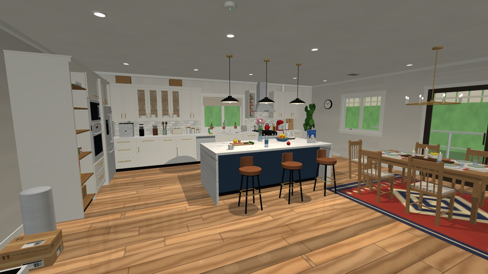

# Detailed kitchen for Unitree G1 / MuJoCo 4.x

A procedurally generated residential open-plan kitchen (about 8 × 7.2 m, 2.75 m ceiling).
It is built from code, not scanned, so every dimension is exact and easy to change.



## Fastest way to see it

Drag **`KITCHEN_VISUAL.xml`** from Finder onto the MuJoCo window. Keep the `assets/` folder
next to it (textures, plus `assets/baked/` meshes).

- The viewer opens on the `kt_entrance` camera. The other cameras (Rendering › Camera) are
  `kt_robot_view`, `kt_island_closeup`, `kt_sink_and_range`, `kt_fridge_pantry`, `kt_dining`,
  `kt_wide_corner` and `kt_top`.
- `kt_top` is an orthographic floor plan. Press **1** to hide the ceiling (geom group 1) for it,
  or whenever you orbit the free camera from above.

## Put the real G1 in it

From the repo root (`GetUp/`):

```bash
python g1_room_mujoco/Kitchen_G1_Detail/BUILD_G1.py
open g1_room_mujoco/Kitchen_G1_Detail/generated
```

Drag **`generated/G1_KITCHEN.xml`** into MuJoCo, keeping `generated/assets/` next to it.

- **Model source:** it uses the Menagerie G1 at `models/mujoco_menagerie/unitree_g1/g1.xml` by
  default. Pass `--g1-xml /path/to/g1.xml` to use another copy.
- **Start pose:** the G1 starts at `(-1.35, -2.2)` facing +y, toward the island, in the clear
  floor area. Change it with `--spawn X Y YAW_DEG`.
- **Collision:** by default the robot collides with the simplified NAV blockers.
  `--visual-only-collision` uses the detailed furniture colliders instead.
- **Keyframe:** the `stand` keyframe is padded for the free props, so `mj_resetDataKeyframe` works.
  Pressing Run without a controller still lets the G1 fall, like the hackathon room.

## What's in the room

| Area | Contents |
|---|---|
| North wall | Shaker base + upper cabinets with brass pulls, quartz counters, subway-tile backsplash with outlets, undermount steel sink + gooseneck faucet under a window with herbs and a roman shade, dishwasher, 5-burner gas range with cast-iron grates and knobs, chimney hood, glass-front uppers with plates/bowls/glasses, open spice shelf, under-cabinet LEDs |
| Counters | Espresso machine + grinder, knife block, utensil crock, toaster, canisters, drying rack, stand mixer, oil/vinegar, grinders, paper towels, cutting boards; pot, pan and kettle on the range |
| West wall | Open pantry (cereal, cans, jars of pasta/rice/beans, oils, baskets of potatoes and onions), wall oven + microwave with lit displays, French-door fridge with dispenser, calendar, drawing, photo and magnets, tall pantry, closed panel door |
| Centre | 2.7 m navy waterfall island (drawers, trash pull-out, outlets), three leather counter stools, three pendant lights; cutting board with sliced tomato/cucumber, fruit bowl, flowers, open cookbook |
| South-east | Oak dining table for six with place settings, candles, chandelier, rug, walnut sideboard with lamp, books and a mirror |
| Shell | Oak plank floor, painted walls, crown and baseboards, recessed cans, smoke detector, vents, patio slider + window onto a deck and backyard, hallway stub through the south doorway |

## Robot-task props

These come from the categories in `tasks.json`:

- **Chairs:** six dining chairs have real collision in both files, so you can sit on them. The
  island stools seat at 0.66 m.
- **Tables:** the island top is at 0.935 m and the dining table at 0.76 m.
- **Lifting / carrying (free bodies):**

  | Prop | Mass | Location |
  |---|---|---|
  | `kt_grocery_box` | 3 kg | floor, by the pantry |
  | `kt_step_stool` | 1.5 kg | floor, by the pantry |
  | `kt_apple` | 0.18 kg | island |
  | `kt_mug` | 0.3 kg | island |
  | `kt_water_bottle` | 0.5 kg | island |
  | `kt_cereal_box` | 0.45 kg | island |

  All of them rest in place (under 1 mm of drift after settling).
- **Floor work:** x −3.3…0.6, y −3.3…−0.8 is clear floor. That covers lying down, exercise and
  falls.

## Files

| File | What it is |
|---|---|
| `build_kitchen.py` | The generator. Edit it and re-run to change anything. |
| `KITCHEN_VISUAL.xml` | Every piece of furniture collides with its own shapes. |
| `KITCHEN_G1_NAV.xml` | Same render, but stools, the dining table and the sideboard collide through one invisible box each. Walls, cabinets, chairs and props keep their real colliders. |
| `BUILD_G1.py` | Merges the G1 and writes `generated/`. |
| `assets/*.png` | Procedural textures (wood, quartz, tile, steel, labels, artwork …). |
| `assets/baked/*.msh` | Decorative geometry baked into one mesh per material (see below). |
| `SCENE_MANIFEST.json` | Geom counts, spawn, props, and the compile/settle check results. |
| `previews/*.jpg` | One render per camera. |

Geom groups, toggled with the number keys in the viewer:

| Group | Contents |
|---|---|
| 0 | Structure, cabinets, furniture, props |
| 1 | Ceiling and everything hung from it |
| 2 | Baked detail meshes |
| 3 | Hidden collision stand-ins for baked furniture (the G1's own colliders are also group 3) |
| 4 | NAV blockers |

## Regenerating

```bash
python g1_room_mujoco/Kitchen_G1_Detail/build_kitchen.py              # XMLs (+ textures if missing)
python g1_room_mujoco/Kitchen_G1_Detail/build_kitchen.py --textures   # also regenerate textures
python g1_room_mujoco/Kitchen_G1_Detail/build_kitchen.py --preview    # also render previews/
python g1_room_mujoco/Kitchen_G1_Detail/build_kitchen.py --no-bake    # all primitives (see below)
```

Then re-run `BUILD_G1.py`. The shared code lives in `../envkit/`:

| File | Role |
|---|---|
| `mjcf.py` | Scene builder |
| `textures.py` | Procedural textures |
| `props.py` | Shared furniture and props |
| `bake.py` | Mesh baking |
| `g1merge.py` | G1 merge |

## Rendering and performance notes

- **Baking.** MuJoCo's renderer issues one draw call per geom, so ~1,900 small primitives
  rendered at ~80 ms/frame. The build bakes all non-colliding detail into ~110 meshes. The scene
  looks the same and renders at ~13 ms/frame at 1280×720 on an M-series Mac (~7 ms with
  Rendering › Shadow off).
- **When to use `--no-bake`.** `web/scripts/sim/export.py` only exports primitive geoms. Build with
  `--no-bake` before exporting this room to the web viewer.
- **Lighting.** It uses three directional lights plus one shadow-casting spotlight. In MuJoCo 4.0.1, a
  spotlight with `castshadow="false"` removes all ambient light from everything outside its cone,
  so ceilings and upper walls render black. `envkit` refuses such lights. The hackathon room's lights
  are set that way, which is why its upper walls fade to black.

## Limitations

- **Visuals only:** doors and drawers are not articulated, and appliances have no interiors.
- **Glass:** window and slider glass collides, so the robot cannot walk through it.
- **Rug:** it is visual only (6 mm), so the robot's feet pass through it.
- **Props:** small props on counters are visual. Only the six listed free bodies can be moved.
