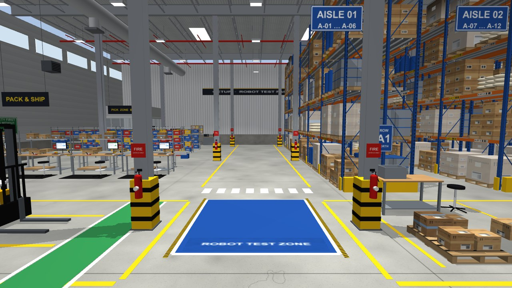

# Detailed warehouse for Unitree G1 / MuJoCo 4.x

A procedurally generated distribution warehouse (30 × 28 m floor, 9 m eaves). It is built from
code, not scanned, so every dimension is exact and easy to change.



## Fastest way to see it

Drag **`WAREHOUSE_VISUAL.xml`** from Finder onto the MuJoCo window. Keep the `assets/` folder
next to it (textures, plus `assets/baked/` meshes).

- The viewer opens on the `wh_entrance` camera. The other cameras (Rendering › Camera) are
  `wh_robot_view`, `wh_rack_aisle`, `wh_docks`, `wh_forklift_closeup`, `wh_packing`,
  `wh_office_break`, `wh_overview` and `wh_top`.
- `wh_top` is an orthographic floor plan. Press **1** to hide the roof and everything hung from it
  (geom group 1) for it, or whenever you orbit the free camera from above.

## Put the real G1 in it

From the repo root (`GetUp/`):

```bash
python g1_room_mujoco/Warehouse_G1_Detail/BUILD_G1.py
open g1_room_mujoco/Warehouse_G1_Detail/generated
```

Drag **`generated/G1_WAREHOUSE.xml`** into MuJoCo, keeping `generated/assets/` next to it.

- **Start pose:** the G1 starts at `(0, -5.65)` facing +y, the same pose as the hackathon room. It
  stands inside the blue **ROBOT TEST ZONE** at the head of the 4 m main aisle. Change it with
  `--spawn X Y YAW_DEG`.
- **Model source:** it uses the Menagerie G1 at `models/mujoco_menagerie/unitree_g1/g1.xml` by
  default. Pass `--g1-xml /path/to/g1.xml` to use another copy.
- **Collision:** by default the robot collides with the simplified NAV blockers (one box per rack run,
  vehicle and bench). `--visual-only-collision` uses the detailed colliders.
- **Keyframe:** the `stand` keyframe is padded for the free props. Without a controller the G1
  falls when you press Run.

## What's in the building

| Area | Contents |
|---|---|
| South | Four dock doors with tracks, springs, diamond-plate levelers, dock lights, controls and DOCK signs. Dock 2 is open onto a 14 m trailer loaded with pallets. There is a drive-in door, two personnel doors with lit EXIT signs, staging lanes with pallets, a forklift (mast, forks, overhead guard, LPG tank, beacon), manual and powered pallet jacks, a hand truck, a stretch wrapper, empty-pallet stacks, cardboard bales, a flammables cabinet, battery chargers, an eyewash station and first aid |
| Centre | 4 m main aisle kept clear end to end, painted robot test zone, zebra crossing, green pedestrian walkway, yellow aisle lines, safety signage |
| Robot task area | Next to the test zone: a lift station with a pallet, a 0.9 m table, a stool and liftable cartons and a tote |
| East | Five runs of blue/orange selective pallet racking (6 bays × 5 levels). The racks have wire decks, beam location labels with barcodes, upright guards, row placards and hanging AISLE signs. Loads are wrapped cartons, carton stacks, drums, sacks and totes |
| West | Four pack stations with monitors, scanners, label printers, scales, tape guns and a half-packed carton, plus mats and stools. A roller conveyor with ~100 rollers, E-stops and cartons runs behind them. There are three rows of bin shelving, a glass office (desk, two monitors, chair, filing cabinet, whiteboard, clock, plant) and a break area (vending machine, water cooler, counter with microwave and coffee maker, table and chairs, cork board) |
| Overhead | Roof deck, girders, bar joists, skylights, high-bay LED fixtures, spiral duct with diffusers, sprinkler mains, unit heaters, clerestory windows, a GETUP · ROBOT TEST FACILITY banner |

## Robot-task props

These come from the categories in `tasks.json`:

- **Chairs:** four pack-station stools, the lift-station stool, the office chair and four break
  chairs all have real collision in both files.
- **Tables:** pack benches and the lift table are at 0.9 m, the break table at 0.75 m.
- **Lifting / carrying (free bodies):**

  | Prop | Mass | Location |
  |---|---|---|
  | `wh_carton_0` … `wh_carton_3` | 2.5–8 kg | on the lift pallet |
  | `wh_floor_carton_0`, `wh_floor_carton_1` | 10 kg, 5 kg | on the floor |
  | `wh_tote` + `wh_tote_item` | — | on the lift table |

  All of them rest in place (under 1 mm of drift after settling).
- **Floor work and walking:** the test zone (3 × 3 m) and the whole main aisle are clear.

## Web viewer compatibility

The web viewer's walking loop (`web/scripts/sim/walk.py`: an oval with |x| ≤ 1.4,
y −5.9…2.6) fits inside the main aisle. This was checked by running its IK in this warehouse:
it converges, and the robot touches nothing but the floor. `web/scripts/sim/export.py` only
exports primitive geoms, so rebuild with `--no-bake` before exporting this scene.

## Files

| File | What it is |
|---|---|
| `build_warehouse.py` | The generator. Edit it and re-run to change anything. |
| `WAREHOUSE_VISUAL.xml` | Racks, vehicles and benches collide with their own shapes. |
| `WAREHOUSE_G1_NAV.xml` | Same render, simplified invisible blockers (group 4). Walls, columns, doors, chairs, the lift station and props keep their real colliders. |
| `BUILD_G1.py` | Merges the G1 and writes `generated/`. |
| `assets/*.png` | Procedural textures (concrete, wall panels, cartons, signs, labels, screens …). |
| `assets/baked/*.msh` | Decorative geometry baked into one mesh per material. |
| `SCENE_MANIFEST.json` | Geom counts, spawn, props, and the compile/settle check results. |
| `previews/*.jpg` | One render per camera. |

Geom groups, toggled with the number keys in the viewer:

| Group | Contents |
|---|---|
| 0 | Structure and props |
| 1 | Roof and everything hung from it |
| 2 | Baked detail meshes |
| 3 | Hidden collision stand-ins for baked furniture (the G1's colliders are also group 3) |
| 4 | NAV blockers |

## Regenerating

```bash
python g1_room_mujoco/Warehouse_G1_Detail/build_warehouse.py              # XMLs (+ textures if missing)
python g1_room_mujoco/Warehouse_G1_Detail/build_warehouse.py --textures   # also regenerate textures
python g1_room_mujoco/Warehouse_G1_Detail/build_warehouse.py --preview    # also render previews/
python g1_room_mujoco/Warehouse_G1_Detail/build_warehouse.py --no-bake    # all primitives
```

Then re-run `BUILD_G1.py`. The shared code lives in `../envkit/`, and rack contents are seeded,
so rebuilds are identical.

## Rendering and performance notes

- **Baking.** The scene has ~7,500 primitives, which rendered at ~140 ms/frame in MuJoCo's
  one-draw-call-per-geom renderer. The build bakes all non-colliding detail into ~130 meshes,
  which brings it to ~20 ms/frame at 1280×720 on an M-series Mac (~9 ms with Rendering › Shadow
  off). Physics costs ~50 µs per step.
- **Lighting.** It uses three directional lights plus one shadow-casting spotlight over the test zone.
  See the kitchen README for why there are no non-shadow spotlights: in MuJoCo 4.0.1 they black out
  ambient light outside their cone.

## Limitations

- **Visuals only:** rack loads above floor level, conveyor cartons and bin contents are visual. Only
  the listed free bodies can be moved.
- **Racks:** in the VISUAL file, floor-level pallets and rack uprights collide. In NAV, each rack run
  is one blocker box.
- **Doors:** doors do not open. The open dock and its trailer are walkable, and the trailer floor is
  level with the building floor.
